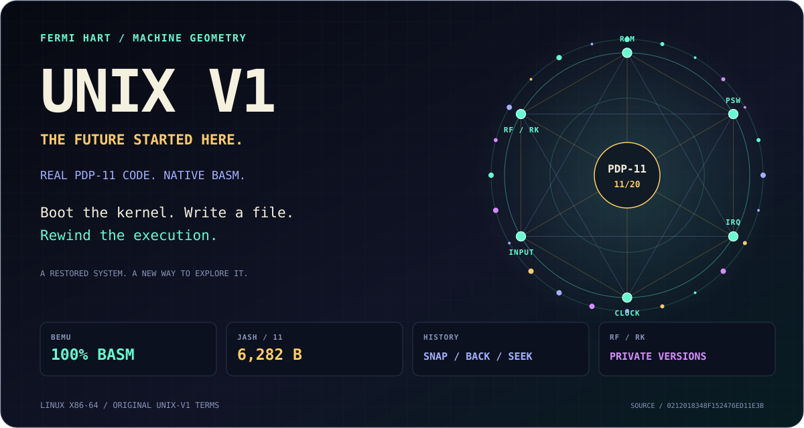
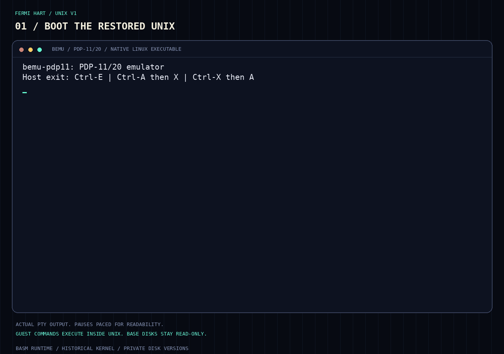
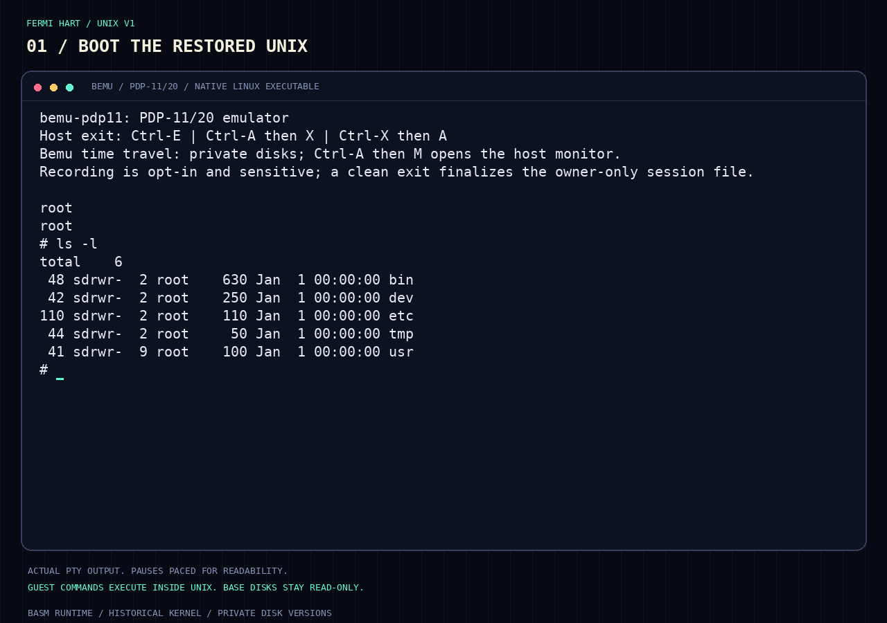
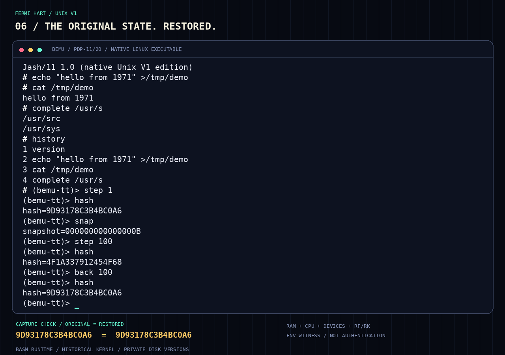
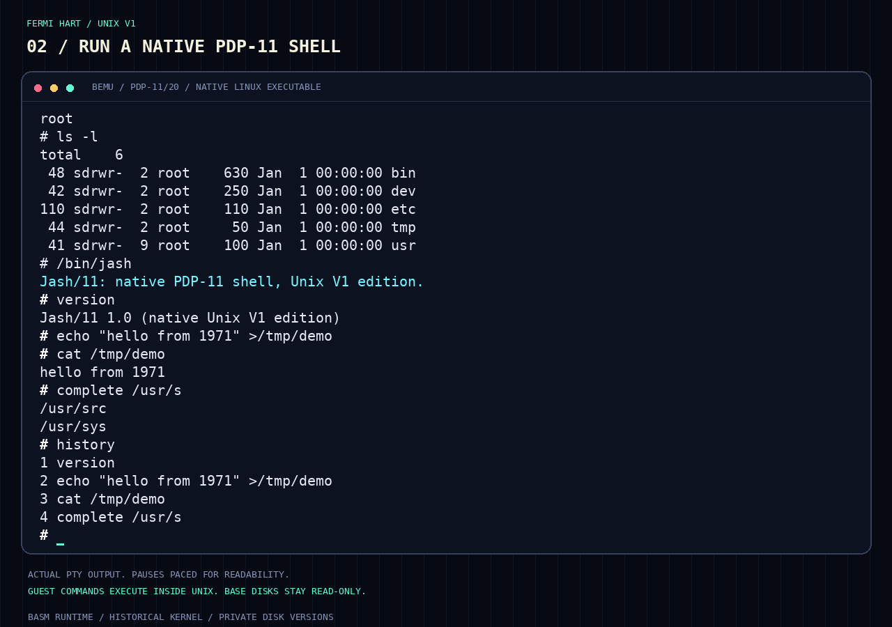

<!-- Local integration additions. -->
<!-- Copyright (c) 2026, F E R M I ∞ H A R T <contact@fermihart.com> -->
<!-- License: original unix-v1 terms; see LICENSE. -->

<p align="center">
  <picture>
    <source media="(max-width: 600px)" srcset="readme/hero-machine-mobile.svg">
    
  </picture>
</p>

<h1 align="center">UNIX V1 — The future started here.</h1>

<p align="center">
  <strong>A foundational operating system. Native Basm execution. A way back.</strong><br>
  <a href="#watch-it-run-then-watch-it-go-back">WATCH IT RUN</a> ·
  <a href="#start-with-a-machine-you-can-rewind">BOOT IT</a> ·
  <a href="https://github.com/FermiHart/basm#get-the-development-candidate">GET BASM</a> ·
  <a href="https://fermihart.github.io/unix-v1/">OPEN THE WEBSITE</a> ·
  <a href="bemu-pdp11/docs/">READ THE MACHINE</a>
</p>

In 1971, at Bell Laboratories, **First Edition UNIX** brought a distinctive
approach to operating systems to the PDP-11/20. Written in assembly, it
supported processes, a hierarchical file system, and multiple users on a
machine with resources that seem impossibly small today.

UNIX had begun on the PDP-7 in 1969. Ken Thompson, Dennis Ritchie, and their
Bell Labs colleagues were developing ideas that would outlive the machines
they first ran on: simple mechanisms, consistent interfaces, and systems
that people could understand and build upon.

That lineage would help shape Linux, macOS, servers, and much of the
infrastructure we now take for granted. **Part of the reason we can build
what we build today is that someone laid these foundations then.**

We wanted more than a photograph of that history.

**We wanted to switch it on. Follow its execution. And find a way back.**

[Start exploring](#start-with-a-machine-you-can-rewind) ·
[Bemu-pdp11](bemu-pdp11/README.md) · [Jash/11](jash11/README.md) ·
[Technical specifications](bemu-pdp11/docs/) · [Changelog](CHANGELOG.md)

## Watch it run. Then watch it go back.

<p align="center">
  <a href="readme/unix-v1-in-action.gif">
    
  </a>
</p>

<p align="center"><em>Actual emulator output, captured through a PTY and
re-rendered as terminal cells. Typed input and pauses are paced for readability.
The capture checks state restoration, verifies session replay, and confirms
the base images are unchanged.</em></p>

| Boot the system | Work inside it | Go back |
|---|---|---|
| ROM-to-kernel boot, `root` login, and a filesystem listing | Native Jash/11, a file write/readback, completion and history | `snap` → `step 100` → `back 100`; the original canonical witness returns |

## Not a picture of UNIX. UNIX, running.

This project builds on the historical Unix V1 restoration described below.
It is a reconstruction of the system around 1972, not an untouched 1971
disk image. The work of its [restorers](CREDITS) makes this experience possible.

Our contribution is a new way to execute, inspect, and experiment with that
system while preserving its restored kernel, historical shell, `init`, and
`getty`. Guest programs still execute as PDP-11 code inside the guest kernel.
There is no host-side script pretending to be the UNIX shell.

<details>
<summary><strong>See the actual Unix V1 login and filesystem</strong></summary>

<p align="center">
  <a href="readme/unix-v1-boot.png"></a>
</p>

</details>

## Two architectures. One operating system.

**Bemu-pdp11 is written entirely in Basm.** It is assembled with Bear Basm,
linked with `ld`, and runs natively on Linux x86-64 using system calls
directly. No libc. No SIMH or QEMU dependency in the native runtime.

Making that work means much more than drawing a terminal window. It means
instruction decoding, effective addressing, condition codes, stacks,
interrupt arbitration, a clock, console queues, and RF/RK disk DMA working
together well enough for the restored kernel to boot and run programs.

```text
Linux x86-64
    └── Bemu-pdp11 — Basm, direct syscalls, no libc
            └── PDP-11/20 + KE11-A + RF/RK + console + clock
                    └── Restored Unix V1 kernel
                            ├── Historical /bin/sh
                            └── Native Jash/11
```

**A ROM-to-shell boot. Real guest instructions. A system you can inspect.**

## What if execution had a way back?

An operating system does not live in RAM alone. Its next instruction also
depends on device registers, pending interrupts, queued input, clock events,
and the disk blocks it just changed.

The Basm time-travel engine captures complete implemented machine state,
keeps private RF/RK disk versions, and records external poll results for
deterministic replay. Create a checkpoint. Advance instructions. Go back.
Seek an earlier execution boundary and reconstruct the path forward.

**This is not rewinding a video. It is restoring a machine and replaying
its execution.**

Base disks stay read-only in temporal modes. Replay checks the resulting
machine state, disk contents, logical console output, and journal position.
The monitor belongs to the emulator, not to a modified guest shell.

<p align="center">
  <a href="readme/time-travel.png"></a>
</p>

The matching values are real FNV witnesses from that captured session,
not an authentication or formal trace-equivalence claim. The footer is a
capture-driver check, separate from guest and monitor output.

## A new shell. Inside the old UNIX.

**Jash/11 runs inside the restored Unix V1 kernel as a native PDP-11 program.**
It uses the historical `fork`/`exec`/`wait` ABI, not a host interpreter.

Quoting. Redirection. Command files and `source`. Session history and
explicit recall. Bounded completion lookup. Native echo and controlled
console presentation.

All within an **8 KiB initialized-code/data budget**, inside the historical
16 KiB user window. It is an independently implemented, deliberately bounded
V1 edition, not a promise of modern-shell or POSIX feature parity.

The goal is not to disguise an old system as a new one. It is to build a
useful new experience while respecting what that system actually supports.

<p align="center">
  <a href="readme/jash11-live.png"></a>
</p>

<details>
<summary><strong>Reproduce the screenshots and animation</strong></summary>

The presentation helper builds the Basm emulator and guest, creates a
private image pair, records the real session, asserts the reverse witness,
and verifies replay before rendering. It does not interpret guest commands
or replace the execution backend.

It requires the normal build dependencies plus Python 3, Pillow, `pyte`,
Fontconfig and DejaVu Sans Mono. With compatible Bear Basm on `PATH`:

```sh
make -C tools
make -C build
python3 readme/generate_media.py
python3 readme/generate_media.py --check
```

Set `BASM` to select another compatible assembler. Raw recordings and
images stay in the printed private workspace; only the curated SVG/PNG/GIF
assets belong in the repository. Geometry is derived from source identity,
not from a security measurement. Witness values can differ between live
captures: the behavior checks, not the media bytes, are reproducible. No
art or license is imported from other projects.

</details>

## Start with a machine you can rewind.

On Linux x86-64, with compatible Bear Basm, GNU `ld`, and the restoration's
build tools available:

```sh
make run-bemu-time
```

The emulator starts paused with private disk versions. Enter `continue` to
boot, then log in as `root`. Press **Ctrl-A, release Ctrl, then M** to open
the host monitor:

```text
(bemu-tt)> snap
(bemu-tt)> step 10
(bemu-tt)> back 10
(bemu-tt)> regs
(bemu-tt)> continue
```

Choose another path when you need it:

| Experience | Command |
|---|---|
| Native Bemu with ordinary writable disks | `make run-bemu` |
| Separate image profile containing Jash/11 | `make run-jash11`, then `/bin/jash` after login |
| Reference SIMH execution | `make run` |
| QEMU → Linux → SIMH → Unix V1 | `make run-qemu` |
| Reproducible release qualification | `make qualify` |

The ordinary build/install targets may replace generated working images;
back them up before using those workflows. Temporal modes never write
their supplied bases. See the component READMEs for build dependencies,
assembler selection, controls, and disk-safety details.

## Explore it. Do not just take our word for it.

The repository includes executable regression tests, private-image boot
tests, reverse/replay checks, malformed-session and capacity tests, and
independent artifact rebuilds. Jash/11 is exercised in both Bemu and SIMH.
The separate QEMU workflow is tested through actual Linux/SIMH/Unix boots.

`make qualify` repeats the functional battery three times and checks
packaging, source attribution, artifact identity, and historical-file/disk
preservation. Missing prerequisites or any failed required stage block
approval. Logs and machine-readable evidence remain private, outside the
source tree. See the [test instructions](bemu-pdp11/README.md#regression-coverage).

This is a supported Unix V1 profile, not complete PDP-11 ISA/peripheral or
physical-hardware certification. Temporal v1 does not offer alternate-input
branches, crash recovery, base writeback, or post-HALT monitoring. Recordings
contain sensitive guest state and need a clean exit to finalize. Navigation
cannot retract output already displayed on your host terminal. The
[temporal contract](bemu-pdp11/docs/TIME_TRAVEL.md) defines the exact limits.

**Computing history does not have to stay behind glass.**

**Switch it on. Read the code. Follow the execution.**

Our contributions use the unchanged original [unix-v1 license](LICENSE).
Historical authorship and third-party notices remain intact; see
[CREDITS](CREDITS) and [CONTRIBUTIONS.md](CONTRIBUTIONS.md).
This product includes software developed or owned by Caldera
International, Inc.

---

## Restoration of 1st Edition UNIX from Bell Laboratories

Welcome to the 1st Edition UNIX repository. Here, you will find the kernel
source code and userland binaries necessary to run 1st Edition UNIX on a
PDP-11 simulator. This repository houses a reconstructed version of UNIX as
it existed around 1972, rather than an original 1st Edition UNIX image.
The reconstruction is based on a printout of the UNIX kernel slightly after
Version 1, supplemented with data recovered from a DECtape dating from around
Versions 2 or 3.

The 1st Edition UNIX marked a significant milestone when UNIX was rewritten
for the then-new PDP-11, a relatively affordable minicomputer, transitioning
from the PDP-7 for which it was originally developed, at Bell Laboratories.
Both versions were crafted in assembly language. The early iterations of UNIX
were quintessential examples of advanced concepts encapsulated within
streamlined systems. The influence of UNIX has been so profound that its
impact resonates well into the 21st century. The developmental history of UNIX
is well-documented, and in the past decade, concerted efforts have been made
to locate and preserve software and documentation artifacts from UNIX's
formative years.

The paper titled "[The Restoration of Early UNIX Artifacts](https://www.usenix.org/legacy/event/usenix09/tech/full_papers/toomey/toomey.pdf)"
by Warren Toomey provides an in-depth account of the endeavors to restore
these historical artifacts to operational condition, along with the valuable
insights gained through this process.

## Build Instructions
Unless otherwise noted, file and directory names refer to this repository.

Simply execute `make`. Doing so initiates several processes. It compiles
`tools/pdp11`, `tools/mkfs`, `tools/ml`, and `tools/apout/apout`. These tools
are essential for constructing the filesystems and the kernel for 1st Edition
UNIX. Additionally, the command prepares kernel sources with requisite patches,
assembles the kernel, and creates a bootable [SIMH](http://simh.trailing-edge.com/)
memory image. This image is then placed into the images directory.

Finally, the `make` will build the `rf0.dsk`, `rk0.dsk` and `tape` images and
install these in the `images` directory. You can also do a `make clean` to clean
out the `images` and `build` directories. A `make distclean` will clean out the
`images`, `build`  and `tools` directories accordingly.

## Running 1st Edition UNIX
1. Execute `make run` or `./simh.cfg`, and you should see this:

```
PDP-11 simulator Open SIMH V4.1-0 Current        git commit id: 1a1396d0
Disabling XQ
RF: buffering file in memory
TC0: 16b format, buffering file in memory
Listening on port 5555
```

   You will receive a `login:` prompt:

2. Type in `root` followed by RETURN key. You should receive a `#` prompt.

3. Type in an `ls -l` command. You should see something like this:

```
total    6
 43 sdrwr-  2 root    620 Jan  1 00:00:00 bin
 42 sdrwr-  2 root    250 Jan  1 00:00:00 dev
104 sdrwr-  2 root    110 Jan  1 00:00:00 etc
114 sdrwr-  2 root     50 Jan  1 00:00:00 tmp
 41 sdrwr-  7 root     70 Jan  1 00:00:00 usr
```

4. To change directories, use `chdir`, e.g. `chdir /usr`. The only editor installed
   is `ed`. You can check [A Tutorial Introduction to the UNIX Text Editor](docs/edtut.pdf) for its usage.

5. To log in multiple times, telnet to localhost port 5555.  The system
   is configured to allow 8 remote logins.

6. To shut the system down, press `Ctrl-E` to stop the simulator, and `q` to quit.
   You do not need to sync the system before shutdown.

## Running 1st Edition UNIX inside QEMU

QEMU has no PDP-11 target, so the kernel cannot boot directly on QEMU.
Instead, `make run-qemu` boots a minimal x86_64 Linux guest whose `/init`
launches the SIMH PDP-11 emulator with the Unix V1 disks (nested
emulation). You get the same `login:` prompt; log in as `root`.
Exit QEMU with `Ctrl-A X`. See [qemu/README.md](qemu/README.md) for details.

## Running with Bemu-pdp11 (100% Basm)

`make run-bemu` boots the same Unix V1 disks in the native Linux x86-64
[Bemu-pdp11](bemu-pdp11/README.md) emulator, written entirely in Basm and
assembled with Bear Basm. It needs neither SIMH nor QEMU at runtime.
Log in as `root`, try `ls -l` and `chdir /usr`, and close Bemu with
`Ctrl-E`, `Ctrl-A` then `X`, or `Ctrl-X` then `A`. These shortcuts work from
the historical shell without adding an `exit` builtin to it.

Run `make test-bemu` for CPU/device regressions and the automated boot test
(login, RF/RK filesystem access, and file writes on private disk copies).
The build looks for Bear Basm as `basm` on `PATH`; override it with
`BASM=/absolute/path/to/basm` when using a compatible derivative.
Download Bear Basm from the [official repository](https://github.com/FermiHart/basm)
or its [Linux x86-64 development packages](https://github.com/FermiHart/basm#get-the-development-candidate).
Check the supplied checksum and follow the package's installation or
run-in-place instructions; GNU `ld` is a separate linking dependency.

## Bemu time travel

`make run-bemu-time` starts the Basm time-travel monitor with read-only base
images and private disk versions. Use `continue` to boot, **Ctrl-A then M**
to pause, `snap` to checkpoint, `step`/`back` for instruction navigation,
and `seek` for exact boundary positions. No kernel or shell debugger hooks
are required. Opt-in `--record NEW.btt` / `--replay SESSION.btt` sessions
support deterministic replay and final-state verification; they contain
sensitive guest memory, disk, and input data.

`make test-time-travel` runs the temporal and original-emulator gates.
See [the time-travel contract](bemu-pdp11/docs/TIME_TRAVEL.md) for precise
limits, persistence, and the distinction between replay and external undo.

## Native Jash/11 edition

`make run-jash11` boots an isolated image containing `/bin/jash`. Log in
as `root`, then run `/bin/jash` to enter the native PDP-11 edition.
The original `# ` prompt is retained with the Jash Midnight palette;
`plain` or `/bin/jash -p` disables ANSI. `exit` returns to `/bin/sh`.

Jash/11 1.0 adds quoting, escapes, redirection, command files, session
history, and bounded completion lookup. This is an independently
implemented V1 edition, not the complete modern Jash. The kernel,
historical shell, and default disks are
not replaced. `make test-jash11` exercises the same guest artifact in
Bemu and SIMH. See [jash11/README.md](jash11/README.md) for its supported
commands, limits, encoding, and license.

## Documentation

For release qualification, run `make qualify` with compatible Bear Basm
available. It repeats the documented Bemu/Jash interfaces in isolated
images, includes real QEMU/TCG boot, preserves working disks, and emits
private per-stage logs plus a machine-readable verdict. See the
[test instructions](bemu-pdp11/README.md#regression-coverage) for requirements
and coverage. Missing prerequisites or any failed gate block approval.
Project changes are summarized in [CHANGELOG.md](CHANGELOG.md).

The [standalone project page](https://fermihart.github.io/unix-v1/) uses the
same verified captures as this README. To preview it locally without a
frontend toolchain:

```sh
python3 website/build.py --output _site
python3 -m http.server --bind 127.0.0.1 --directory _site 8000
```

The builder accepts only new/empty output directories and stages an explicit
allowlist: HTML, CSS, the original license and the six curated media assets.
Raw sessions, disks, logs and host executables are never copied into the site.

The manuals for 1st Edition UNIX are available here:
<https://web.archive.org/web/20250114151916/https://www.bell-labs.com/usr/dmr/www/1stEdman.html>,
<https://www.tuhs.org/Archive/Distributions/Research/Dennis_v1/UNIX_ProgrammersManual_Nov71.pdf>, and
<https://man.cat-v.org/unix-1st/>.

Some documentation of the internals of the 1st Edition UNIX are available here:
<http://www.bitsavers.org/pdf/att/unix/Early_UNIX/PreliminaryUnixImplementationDocument_Jun72.pdf>

Details of the PDP-11/20 architecture and its peripherals can be found at:
<http://www.bitsavers.org/pdf/dec/pdp11/handbooks/PDP1120_Handbook_1972.pdf>, and
<http://www.bitsavers.org/pdf/dec/pdp11/handbooks/PDP11_PeripheralsHbk_1972.pdf>.

The C compiler from 2nd Edition UNIX has been installed and is operational.
However, it supports a very early dialect of C. The most relevant reference for
this version of the language is as follows, although it may be approximately
two years more advanced than the dialect in question:
<https://web.archive.org/web/20240425202413/https://www.bell-labs.com/usr/dmr/www/cman74.pdf>

The userland binaries originate from a period between the 1st and 2nd Editions
of UNIX. The manuals from the 2nd Edition may also be useful:
<http://www.bitsavers.org/pdf/att/unix/Early_UNIX/Unix_2nd_Edition_Manual_Jun72.pdf>.

## Repository Layout
* `pages`
    - OCR'd pages from the [Preliminary Release of UNIX Implementation Document](docs/PreliminaryUnixImplementationDocument_Jun72.pdf).
* `patches`
    - patches to rebuilt files to get kernel to run
* `fs`
    - userland binaries and files, used to make rf0.dsk and rk0.dsk
* `src`
    - source code for userland: there is not much available
* `tools`
    - tools and scripts to build the kernel and filesystem
* `build`
    - build area: patched kernel files, patched filesystems
* `images`
    - final disk and tape images to be used by the SIMH simulator
* `notes`
    - notes on the work done to get 1e UNIX to run again

## License

In 2002, Caldera International made Unix V1 through V7 for PDP-11 and Unix 32V
for VAX available as free and open source software, adopting a permissive
BSD-style license. Consequently, any work derived from Unix V1, as well as
portions of V2 and V3, falls under this same BSD-style licensing.

Use of this repository is governed by a BSD-style license that can be found in
the [LICENSE](LICENSE) file. Apout is redistributed under the MIT License,
which can be found in the [LICENSE.Apout](LICENSE.Apout) file.

The Bemu-pdp11 implementation and QEMU integration contributions use the
same original `unix-v1` terms in [LICENSE](LICENSE), not a separate house
license. The original copyright notice, conditions, and disclaimer remain
unchanged. Existing third-party components retain their respective notices.

This product includes software developed or owned by Caldera
International, Inc.

Check the [CREDITS](CREDITS) file to see who participated in the restoration.

## Local integration attribution

Copyright (c) 2026, **F E R M I ∞ H A R T** —
[contact@fermihart.com](mailto:contact@fermihart.com).
This attribution covers our additions, not the historical UNIX authorship.
See [CONTRIBUTIONS.md](CONTRIBUTIONS.md) for scope and header conventions.

## Related Projects
* [7th Edition Unix at 40](https://2019.eurobsdcon.org/slides/7th%20Edition%20Unix%20at%2040%20-%20Warner%20Losh.pdf) / [video](https://youtu.be/FTlzaDgzPY8)
* [pdp7-unix](https://github.com/DoctorWkt/pdp7-unix) resurrects Unix on the PDP-7 from scans of the original assembly code.
* [The Unix Heritage Society](https://www.tuhs.org/)
* [Unix History Repository](https://github.com/dspinellis/unix-history-repo)
* [Warner's History of Unix BSDCan 2020 Talk](https://github.com/bsdimp/bsdcan2020-demos)
* [Research UNIX v7 for Raspberry Pi](https://github.com/r1mikey/research-unix-v7)
* [ed Editor V1 Javascript Edition](https://github.com/dkkloimwieder/eded.js)
* [pdp11-B](https://github.com/rswier/pdp11-B)  is an effort to recreate the B compiler for the PDP-11 as authentically as possible.
* [B compiler](https://github.com/aap/b) is capable of compiling itself.
